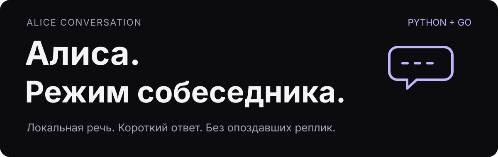

# Алиса — режим собеседника

<p align="center"></p>

Python-сервер и Go-клиент для фонового участия умной колонки в разговоре. В отличие от обычного «вопрос → ответ», здесь модель решает, есть ли повод добавить короткую реплику после паузы. Новая речь, выключение режима или потеря связи отменяют устаревший ответ.

Это публичное ядро существующей разработки: код обработки, протокол, клиент и автоматические проверки. **Готового установщика на колонку в репозитории нет.**

## Что реализовано

- **Распознавание на своём сервере:** Vosk и WebRTC VAD, без загрузки модели при старте.
- **Короткие реплики:** до двух предложений, после паузы не меньше 1,2 с, не чаще одного раза в 15 с. Это ограничение частоты, а не таймер обязательных ответов.
- **Отмена без опоздавшей речи:** поколения запросов и версии состояния; поздний ответ модели не должен оживить прерванную реплику.
- **Управление:** `on`, `off`, `stop`, `reset`, `direct`; клиент сохраняет выбор `enabled`, а временная блокировка его не переписывает.
- **Ограниченные очереди:** потеря потока или heartbeat блокирует работу вместо накопления старого аудио.
- **Без записи разговоров:** аудио и распознанный контекст — в оперативной памяти; на диске клиента остаётся выбор режима. Внешняя текстовая модель получает распознанные фразы, не PCM.

## Быстрый старт: проверить код без колонки

Нужны Linux, Python **3.13**, Go **1.27.3** и C-компилятор для Go race detector. Модель Vosk, аккаунт провайдера, ключи и доступ к устройству для тестов не нужны.

```sh
git clone https://github.com/vladokan42/alice-conversation.git
cd alice-conversation
python3.13 -m venv .venv
.venv/bin/python -m pip install -r server/requirements.txt
(cd server; ../.venv/bin/python -B -W error::ResourceWarning -m unittest discover -s tests -v)

(cd device; GOWORK=off GOTOOLCHAIN=go1.27.3 GOFLAGS=-mod=readonly go test -race -count=1 ./...)
```

Тесты действительно исполняют движок, HTTP/WebSocket, обработку состояния и отмену. На границах ASR/VAD/модели и Glagol используются явные тестовые реализации и синтетические данные. Успех тестов **не означает**, что проверены микрофон, слышимый голос или распознавание телевизора в комнате. Подробности: [VALIDATION.md](docs/VALIDATION.md).

## Две части проекта

| Часть | Что делает | Инструкция |
|---|---|---|
| `server/` | Принимает PCM, распознаёт речь, обращается к OpenAI-совместимой текстовой модели, возвращает короткий текст или молчит | [Сервер](server/README.md) |
| `device/` | Принимает PCM от внешнего источника, ведёт состояние, соединяется с сервером и передаёт свою реплику в Glagol | [Go-клиент](device/README.md) |

Протокол: [PROTOCOL.md](docs/PROTOCOL.md). Сборка ARM64:

```sh
(cd device; GOWORK=off GOTOOLCHAIN=go1.27.3 GOFLAGS=-mod=readonly \
  CGO_ENABLED=0 GOOS=linux GOARCH=arm64 \
  go build -buildvcs=false -trimpath -o /tmp/alice-ambient ./cmd/alice-ambient)
```

Команда только собирает файл, не устанавливает его. Выбери свою папку вывода, если `/tmp` не подходит.

## Что нужно для собственной интеграции

1. **Источник PCM** 16 кГц/моно/s16le с корректным отключением передачи при аппаратном mute и собственной речи. Go-клиент сам микрофон не захватывает.
2. **Свои TLS и ограниченные токены** для соединений, свой подтверждённый Glagol-сертификат и адаптер команд Bridge. Проверки TLS отключать нельзя.
3. **Локальная модель Vosk** и совместимый текстовый endpoint. Можно использовать собственный gateway; платный ключ Google AI Studio не является обязательным условием архитектуры.
4. **Отдельная аппаратная проверка** mute, прямого обращения, прерывания, собственной озвучки, перезагрузки и восстановления связи на своём устройстве.

Здесь нет прошивки, root-инструкции, PCM-инжектора, изменённого Quasar Bridge, VPN, домашнего reverse proxy, выдачи сертификатов или автоматической установки. Для прямого диалога существует отдельный проект [alice-gemini-bridge](https://github.com/vladokan42/alice-gemini-bridge); он не заменяет интеграцию фонового режима.

## Границы

Лексический фильтр и VAD — **не надёжное отделение телевизора или чужой музыки**. Контекст ограничен временем и объёмом, между перезапусками не сохраняется. Отправленный внешней модели текст уже нельзя «отозвать» отменой запроса: код отбрасывает его поздний результат. Свой провайдер может хранить запросы — проверь его политику.

Сервер рассчитан на защищённое соединение от своего клиента, не на открытый публичный сервис. Пользуйся режимом только с ведома присутствующих. Подробнее: [SECURITY.md](SECURITY.md).

## Авторство

Собственный код — MIT, © 2026 Vladislav Okan. Это не официальный продукт Яндекса. WebSocket-клиент использует `coder/websocket` под ISC; полный текст уведомления сохранён в [device/THIRD_PARTY_NOTICES.txt](device/THIRD_PARTY_NOTICES.txt). Модели, аудиопримеры и сторонняя прошивка не распространяются. [Происхождение и состав](docs/PROVENANCE.md).
